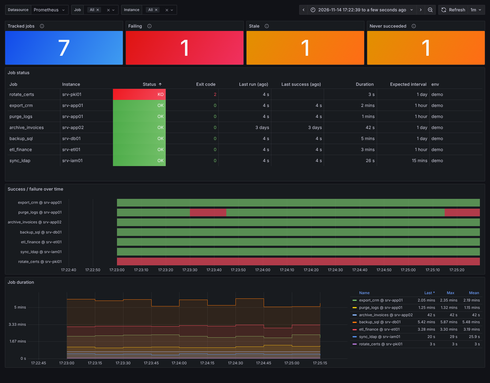

# pushjob — know when your cron jobs fail

One Bash script that wraps any command and pushes its result to a Prometheus **Pushgateway**, plus a Grafana dashboard and alerts.



```bash
export PUSHGATEWAY_URL=http://pushgateway:9091
./pushjob.sh -j backup_sql -i 86400 -l env=prod -- /opt/scripts/backup_sql.sh
```

- Your job's **exit code is returned unchanged**
- A Pushgateway outage **never fails your job**
- Pushes duration, exit code, success, last run / last success / last failure timestamps
- `-i 86400` = "this job should succeed every 24 h" → alert if it silently stops running

## Install

```bash
curl -fsSLO https://raw.githubusercontent.com/DevOpshelian/pushjob/main/pushjob.sh
chmod +x pushjob.sh
```

Requires bash ≥ 4 and curl.

| Option | Meaning |
|---|---|
| `-j name` | Job name (required) |
| `-i seconds` | Expected interval between successful runs |
| `-l key=value` | Extra label (repeatable) |
| `-u url` | Pushgateway URL (default `$PUSHGATEWAY_URL`, then `http://localhost:9091`) |

Environment: `PUSHGATEWAY_BASIC_AUTH` (`user:password`), `PUSHGATEWAY_TIMEOUT` (default 5 s), `PUSHJOB_INSTANCE` (default: short hostname).

## Prometheus

```yaml
rule_files:
  - batchjob.rules.yml          # from rules/
scrape_configs:
  - job_name: pushgateway
    honor_labels: true          # mandatory
    static_configs:
      - targets: ["pushgateway:9091"]
```

Included alerts: `BatchJobFailed`, `BatchJobStale`.

## Grafana

Dashboards → New → Import → `dashboards/batchjob-overview.json` → pick your Prometheus datasource.

## Need more?

The **[Batch Job Observability Pack](https://bonnyophelie.gumroad.com/l/batchjob-observability)** adds:

- **PowerShell module** for Windows (5.1 and 7) — Task Scheduler ready, robocopy-style exit codes
- **Helm chart**: Pushgateway + `PrometheusRule` + dashboard `ConfigMap`, one `helm install`
- 3 more alerts: never succeeded, unusually slow job, Pushgateway down
- `docker compose` quickstart, cron / systemd / Task Scheduler / GitLab CI examples
- Unit-tested rules, end-to-end tested wrappers, and future updates

## License

MIT
